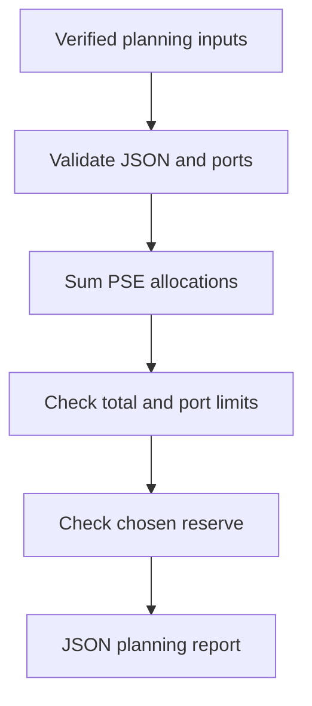

# PoE Budget Planner

An offline Python command-line tool for checking a proposed Power over Ethernet load against a switch's stated PoE budget, individual port limits, and a chosen reserve target.

Prepared for the networking and IT support portfolio of **Alhussin Ali Abutalib**, with AI assistance. This is a tested software exercise using synthetic inputs, not evidence of a physical installation.

## Problem and purpose

An IP camera or access point rollout needs a documented power plan. Available ports alone do not establish sufficient power capacity. This tool makes the arithmetic explicit and produces a JSON report suitable for review or an incident handover.

## Requirements

- Python 3.10 or newer; standard library only.
- Verified switch specifications and PSE-side allocation values for real planning.
- No API keys, network access, dependencies, or device credentials.

## Quick start

```bash
git clone https://github.com/kahrhm2970-source/poe-budget-planner.git
cd poe-budget-planner
python planner.py examples/inventory.json
python -m unittest -v
```

The supplied example intentionally returns exit **1** because the reserve target is not met. This is a planning finding, not a program crash.

To save output, choose a new path and enable your shell's overwrite protection if needed:

```bash
python planner.py examples/inventory.json > my-report.json
```

Shell redirection can overwrite existing files; the tool itself only prints to stdout.

## Input schema

Use JSON numbers, not strings. All fields are required; unknown fields are rejected.

| Field | Meaning |
|---|---|
| `budget_w` | Actual available PoE output budget, not total PSU rating; positive, at most 1,000,000 W |
| `reserve_percent` | Chosen fraction of the total budget to keep unused; 0 inclusive to 100 exclusive |
| `poe_ports` | Number of usable PoE ports; integer 1–10,000 |
| `devices` | Nonempty array, one entry for each occupied PoE port |
| `port` | Unique integer from 1 through `poe_ports`; a logical planning index |
| `pse_w` | Planned worst-case allocation at the switch/PSE for that device; positive |
| `port_limit_w` | Verified power limit for that particular port; positive |

Power values must be finite and at most 1,000,000 W. Duplicate JSON keys, duplicate ports, booleans masquerading as numbers and invalid schemas are rejected. UTF-8 with or without BOM is supported. Watt values in the output are decimal strings to preserve exact arithmetic; avoid using excessive numeric precision in inputs.

## Calculation and decisions

- Demand = sum of all `pse_w` values.
- Planning limit = `budget_w × (1 − reserve_percent / 100)`.
- Physical remaining = budget minus demand.
- Planning remaining = planning limit minus demand (negative means a reserve shortfall).
- `BLOCKED`: any per-port limit exceeded or aggregate demand exceeds the physical budget.
- `REVIEW`: physical and port limits pass, but the chosen reserve target is missed.
- `WITHIN_INPUT_LIMITS`: all these arithmetic checks pass. It does **not** certify compatibility or deployment readiness.

Exact equality is allowed. Reserve is a user-selected planning policy, not an IEEE requirement. Port labels represent a single switch; multiple switches must be evaluated separately.

## Demonstration results

The synthetic example models four 15 W allocations and two 25 W allocations on an eight-port switch with a 120 W PoE budget and 20% reserve.

| Check | Result |
|---|---|
| Total demand | 110 W |
| Physical remaining | 10 W |
| Planning limit | 96 W |
| Planning remaining | −14 W |
| Free PoE ports | 2 |
| Status | REVIEW |

See [the generated output](examples/result.json). These are invented planning allocations, not measured camera consumption or advertised specifications of a named switch.

## Validation

Twelve automated tests passed locally on 9 November 2026. They cover normal capacity, physical overload, reserve shortfall, per-port overload, exact/decimal boundaries, invalid numeric values, invalid/duplicate ports, schemas, duplicate JSON keys and CLI exit codes.

Exit codes: **0** within input limits; **1** planning finding (`REVIEW` or `BLOCKED`); **2** invalid input or file read error. Hardware tests have not been performed.

## Workflow



## Engineering limits

This tool does not discover or configure switches, negotiate power, model cable loss, verify IEEE standards/classes, power pairs, startup peaks, ambient temperature, redundancy, PoE priority or PSU derating. Enter suitable PSE-side worst-case allocations that account for the relevant device and cabling conditions. Do not compare typical PD consumption directly with PSE output capacity. Review actual switch/PSU configuration, vendor data sheets, port capabilities and device compatibility before installation. A reserve percentage cannot substitute for those checks.

## Lessons learned and career relevance

- Separate switch-wide constraints from individual port constraints.
- Distinguish available capacity from a chosen expansion reserve.
- Validate data before presenting a confident result.
- Use exact decimal arithmetic and test boundary conditions.
- Document assumptions so another support technician can review the plan.

## Repository layout

```text
planner.py               # validation, arithmetic, CLI
test_planner.py          # twelve tests
examples/inventory.json  # synthetic input
examples/result.json     # generated output
docs/field-checklist.md   # manual hardware review checklist
README.md
.gitignore
```

## Privacy

Use synthetic examples in public. Never commit credentials, customer inventories, serial numbers, live network addresses, private site layouts, or device configurations. `.gitignore` reduces accidental inclusion of common local files; it is not a secret scanner.

## Portfolio series and next step

This complements the [Network Incident Report Generator](https://github.com/kahrhm2970-source/network-incident-report-generator) and [Switch Config Auditor](https://github.com/kahrhm2970-source/switch-config-auditor). Next: record an actual lab's power allocations and compare them with the plan, after checking suitable hardware and permissions.

## References and contact

- [Cisco: Configuring PoE](https://www.cisco.com/c/en/us/td/docs/switches/lan/catalyst_microswitches/software/releases/15_2_8_e/configuration_guide/int_hw/b_1528e_int_and_hw_cms_cg/configuring_poe.html) — power budgets, allocations and cable-loss considerations; its hardware-specific values are not universal defaults.
- [Python decimal](https://docs.python.org/3/library/decimal.html)
- [Python unittest](https://docs.python.org/3/library/unittest.html)
- [GitHub profile](https://github.com/kahrhm2970-source)
- [LinkedIn](https://www.linkedin.com/in/alhussin-abutalib-02696a416/)
